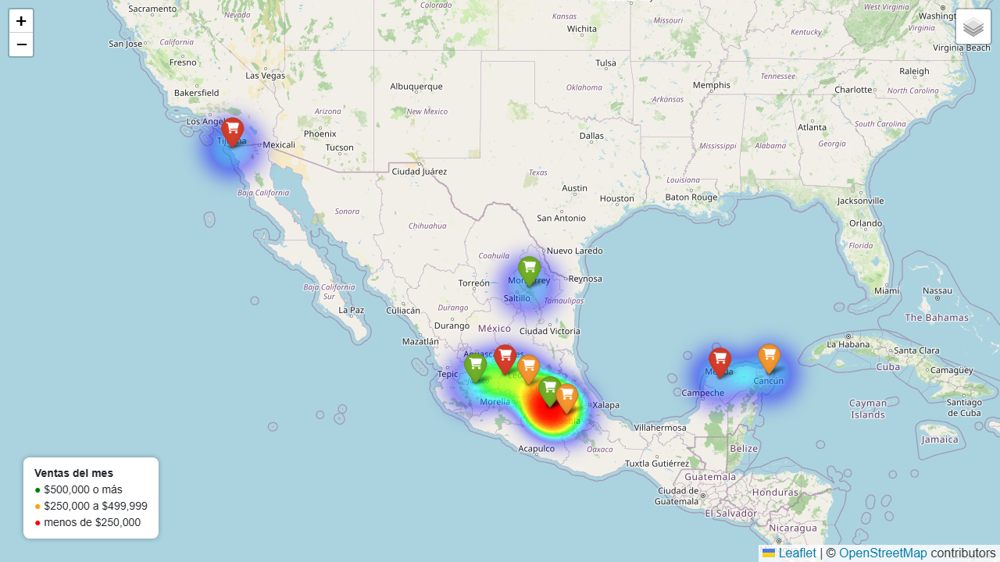

# 🗺️ Mapa interactivo de sucursales con Python

Convierte una tabla de sucursales (nombre, ciudad, coordenadas, ventas) en un **mapa interactivo** que se abre en el navegador:

- 📍 Un marcador por sucursal, **verde, naranja o rojo** según sus ventas.
- 💬 Al pasar el mouse se ve el nombre; al dar clic, la ciudad y las ventas.
- 🔥 Un **mapa de calor** que se pinta más fuerte donde se vende más.
- 🧭 Selector de capas para prender o apagar marcadores y calor, y una leyenda.



> Las sucursales son de ejemplo (una "Tienda PyHero" inventada); las coordenadas son las de cada ciudad.

## Cómo correrlo

1. Instala las librerías (una sola vez):

   ```bash
   pip install pandas folium
   ```

2. Corre el script:

   ```bash
   python mapa.py
   ```

3. Se crea `mapa_sucursales.html` y se abre en tu navegador. Ese archivo lo puedes mandar por correo o abrirlo en cualquier compu: no necesita Python.

## Úsalo con tus propios datos

Edita `sucursales.csv` (se abre con Excel) y deja estas columnas:

| Columna | Qué va | Ejemplo |
| --- | --- | --- |
| `nombre` | Nombre de la sucursal | Tienda Centro |
| `ciudad` | Ciudad (solo se muestra en el popup) | Puebla |
| `lat` | Latitud | 19.0414 |
| `lon` | Longitud | -98.2063 |
| `ventas` | Un número (ventas, clientes, lo que quieras medir) | 310000 |

**¿Tus datos están en Excel?** Cambia esta línea de `mapa.py`:

```python
df = pd.read_excel(CARPETA / "sucursales.xlsx")   # necesita: pip install openpyxl
```

**¿Mides otra cosa que no son ventas?** Cambia los límites de `color_por_ventas()` (500,000 y 250,000) y el texto de la leyenda.

## ¿De dónde saco las coordenadas?

- **Google Maps:** da clic derecho sobre el lugar. El primer renglón del menú son las coordenadas (por ejemplo `19.4326, -99.1332`); dale clic y se copian. El primer número es `lat`, el segundo `lon`.
- **Ojo con el signo:** en México la longitud (`lon`) siempre es **negativa**. Si un punto te sale en Asia, le falta el `-`.
- **¿Solo tienes direcciones y son muchas?** Se pueden convertir a coordenadas en automático con la librería `geopy` (geocodificación). Los servicios gratuitos tienen límite de consultas por segundo, así que conviene hacerlo una vez y guardar las coordenadas en el archivo.

## Errores comunes

| Error | Solución |
| --- | --- |
| `ModuleNotFoundError: No module named 'folium'` | Falta instalar: `pip install folium` |
| `FileNotFoundError: sucursales.csv` | El CSV debe estar en la misma carpeta que `mapa.py` |
| `KeyError: 'lat'` | Las columnas deben llamarse exactamente `lat` y `lon` (minúsculas, sin espacios) |
| El mapa sale en blanco | Los mapas base se descargan de internet: revisa tu conexión |
