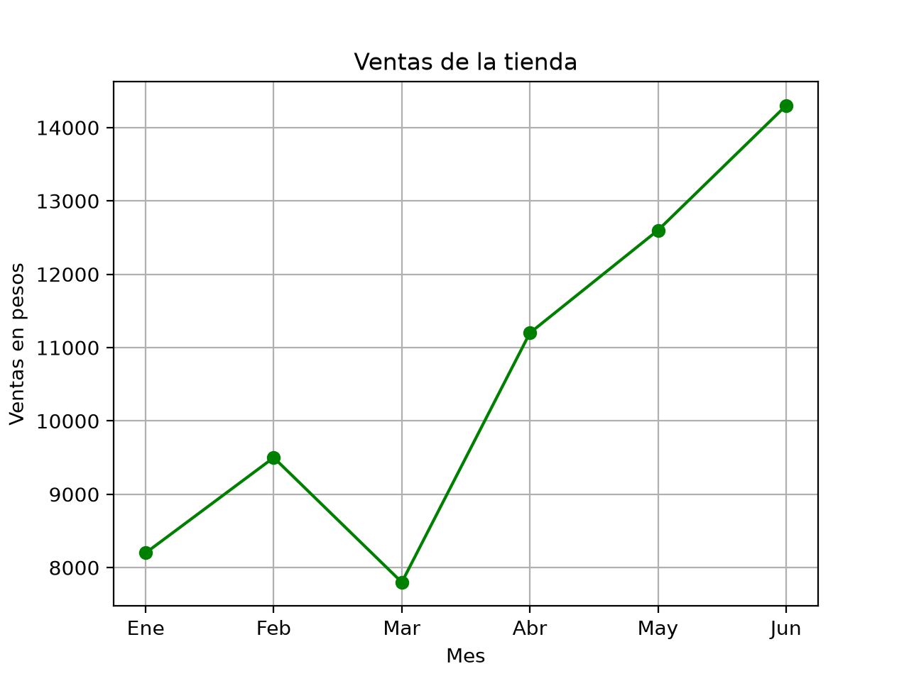

# Episodio 1: tu primera gráfica (líneas)

| Archivo | Qué hace |
| --- | --- |
| `primera_grafica.py` | La XP de la semana: `plt.plot`, `title`, `xlabel`, `ylabel` y `show` |
| `boss_ventas.py` | Boss: ventas de 6 meses con `marker="o"`, `color` y `grid` |
| `mision.py` | Misión resuelta: la temperatura de tu semana (con el bonus) |

## Errores comunes

| Error | Solución |
| --- | --- |
| `ModuleNotFoundError: No module named 'matplotlib'` | Falta instalar: `pip install matplotlib` |
| `ValueError: x and y must have same first dimension` | Las dos listas deben tener el mismo número de datos |
| El programa no termina | Cierra la ventana de la gráfica: `plt.show()` espera a que la cierres |
