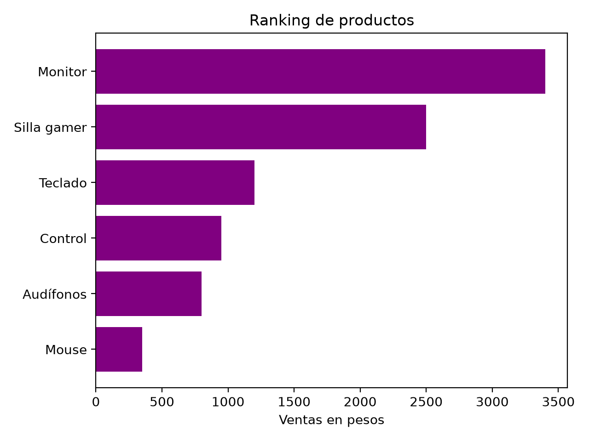

# Episodio 2: gráficas de barras

| Archivo | Qué hace |
| --- | --- |
| `barras_ventas.py` | Lee `ventas.xlsx`, agrupa por vendedor y dibuja las barras con `plt.bar`; guarda `ventas.png` |
| `boss_ranking.py` | Boss: ranking de productos con `sort_values` y barras horizontales (`barh`); guarda `ranking.png` |
| `mision.py` | Misión resuelta: tus gastos de la semana desde `gastos.xlsx`, de mayor a menor (bonus) |

`ventas.xlsx` y `gastos.xlsx` son los mismos del Nivel 5: corre los scripts dentro de esta carpeta.

## Errores comunes

| Error | Solución |
| --- | --- |
| La imagen PNG sale en blanco | `plt.savefig()` va **antes** de `plt.show()` |
| Se cortan los nombres largos | Agrega `plt.tight_layout()` antes de `savefig` |
| `FileNotFoundError: ventas.xlsx` | Corre el script desde esta carpeta (donde está el Excel) |
| `ModuleNotFoundError: No module named 'openpyxl'` | `pip install openpyxl` (pandas lo usa para leer Excel) |
| El campeón sale hasta abajo en `barh` | Ordena de menor a mayor con `sort_values()`: `barh` dibuja de abajo hacia arriba |
