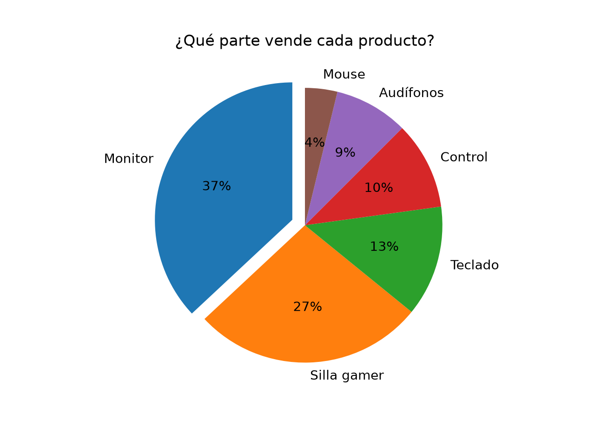

# Episodio 3: gráficas de pastel

| Archivo | Qué hace |
| --- | --- |
| `pastel_ventas.py` | Lee `ventas.xlsx`, agrupa por vendedor y dibuja el pastel con `plt.pie` y porcentajes (`autopct`); guarda `pastel.png` |
| `boss_productos.py` | Boss: qué parte vende cada producto, ordenado con `sort_values`, con la rebanada del campeón separada (`explode`) y empezando arriba (`startangle=90`); guarda `productos.png` |
| `mision.py` | Misión resuelta: el pastel de tu presupuesto del mes, con la rebanada del ahorro separada (bonus) |

`ventas.xlsx` es el mismo del Nivel 5: corre los scripts dentro de esta carpeta.

## Errores comunes

| Error | Solución |
| --- | --- |
| El pastel no se entiende | Usa pastel solo para partes de un total y con **6 rebanadas o menos**; si son más, mejor barras |
| `autopct` no muestra el `%` | Escribe `"%1.0f%%"`: el `%%` final es el que pinta el signo de por ciento |
| `ValueError` con `explode` | La lista de `explode` debe tener **un número por rebanada** (6 productos → 6 números) |
| La imagen PNG sale en blanco | `plt.savefig()` va **antes** de `plt.show()` |
| `FileNotFoundError: ventas.xlsx` | Corre el script desde esta carpeta (donde está el Excel) |
