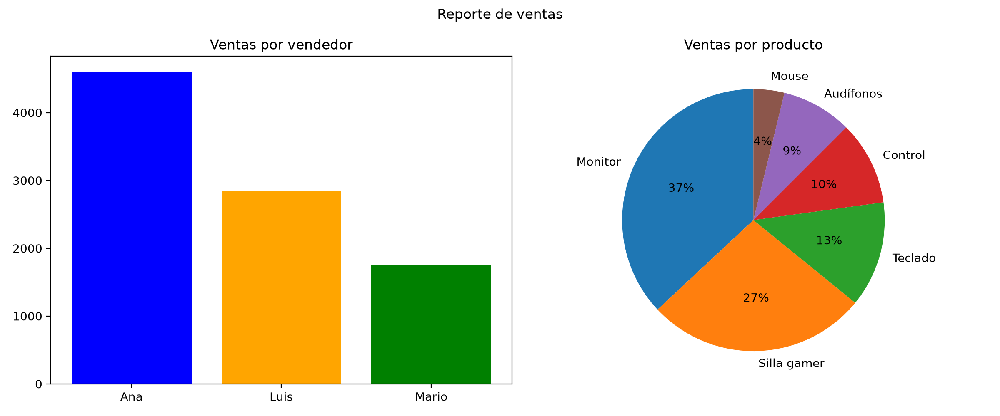

# Episodio 4: Boss final, tu dashboard

| Archivo | Qué hace |
| --- | --- |
| `primer_dashboard.py` | Tu XP en líneas y tus monedas en barras, lado a lado, con `plt.subplots(1, 2)` |
| `boss_reporte.py` | Boss final: lee `ventas.xlsx` y arma un reporte con las ventas por vendedor (barras) y por producto (pastel); guarda `reporte.png` |
| `mision.py` | Misión resuelta: el reporte completo con una tercera gráfica, el ranking de productos con `barh` (bonus: `set_xlabel`) |

`ventas.xlsx` es el mismo del Nivel 5: corre los scripts dentro de esta carpeta.

## Con ejes, los títulos llevan `set_`

| Una sola gráfica (`plt`) | Varias gráficas (`ejes[i]`) |
| --- | --- |
| `plt.plot(...)` | `ejes[0].plot(...)` |
| `plt.title("...")` | `ejes[0].set_title("...")` |
| `plt.xlabel("...")` | `ejes[0].set_xlabel("...")` |
| `plt.ylabel("...")` | `ejes[0].set_ylabel("...")` |

## Errores comunes

| Error | Solución |
| --- | --- |
| `TypeError: 'Text' object is not callable` o `AttributeError: 'Axes' object has no attribute 'xlabel'` | Con ejes se usa `set_title`, no `title` (igual con `set_xlabel` y `set_ylabel`) |
| `IndexError: index 2 is out of bounds for axis 0 with size 2` | Pediste `subplots(1, 2)` y usaste `ejes[2]`: los ejes se cuentan desde 0, así que con 2 gráficas solo existen `ejes[0]` y `ejes[1]` |
| Las gráficas salen apretadas | Dale tamaño con `figsize=(12, 5)` y agrega `plt.tight_layout()` |
| La imagen PNG sale en blanco | `plt.savefig()` va **antes** de `plt.show()` |
| `FileNotFoundError: ventas.xlsx` | Corre el script desde esta carpeta (donde está el Excel) |
