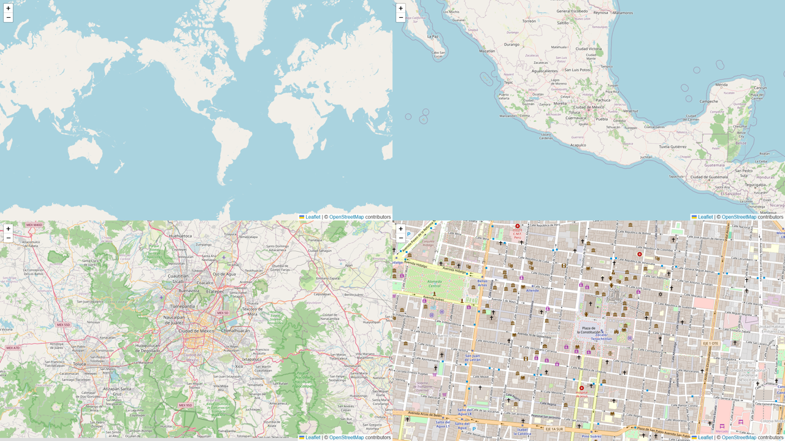

# Episodio 1: tu primer mapa

| Archivo | Qué hace |
| --- | --- |
| `primer_mapa.py` | Crea un mapa centrado en el Zócalo de la Ciudad de México y lo guarda como `mapa.html` |
| `boss_zoom.py` | Boss: con un `for` crea 4 mapas, del planeta entero (zoom 2) a las calles del Centro (zoom 16) |
| `mision.py` | Misión resuelta: el mapa de tu ciudad (Monterrey de ejemplo), con el bonus de vista de satélite |

Corre un script y abre el `.html` que se crea con doble clic: se ve en tu navegador y puedes moverlo y hacerle zoom.

## Cómo sacar tus coordenadas

En Google Maps, dale **clic derecho** a cualquier lugar: el primer renglón del menú son la latitud y la longitud
(por ejemplo `19.4326, -99.1332`). En `location` van en ese orden: `[latitud, longitud]`.

## Errores comunes

| Error | Solución |
| --- | --- |
| `ModuleNotFoundError: No module named 'folium'` | `pip install folium` |
| El mapa sale en otro lado del mundo | Revisa el orden: primero la latitud y luego la longitud. En México la longitud es **negativa** |
| El mapa sale gris, sin calles | Los mapas se descargan de internet al abrir el `.html`: revisa tu conexión |
| `tiles="CartoDB ..."` sale con "API KEY REQUIRED" | Esos mapas ahora piden una clave; usa el mapa normal o `tiles="Esri.WorldImagery"` |

Mapas: © [OpenStreetMap](https://www.openstreetmap.org/copyright) contributors.
