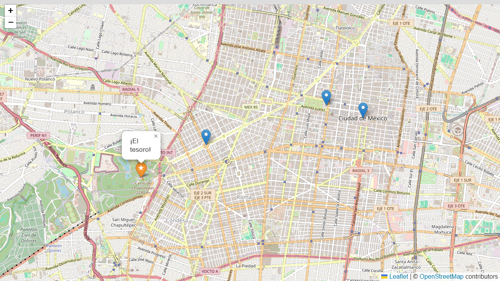

# Episodio 2: marcadores y popups

| Archivo | Qué hace |
| --- | --- |
| `marcador.py` | Un pin rojo en el Zócalo, con `popup` (sale al dar clic) y `tooltip` (sale al pasar el mouse) |
| `boss_ruta_tesoro.py` | Boss: la Ruta del Tesoro. Con un `for` pone un marcador por cada pista de una lista, y el tesoro va aparte con su propio ícono |
| `mision.py` | Misión resuelta: tus 3 lugares favoritos (Monterrey de ejemplo), cada uno con su popup y, de bonus, de su color |

Corre un script y abre el `.html` que se crea con doble clic. Pasa el mouse por un pin y dale clic.



## Las partes de un marcador

```python
folium.Marker(
    [19.4326, -99.1332],              # dónde va: [latitud, longitud]
    popup="¡Aquí es el Zócalo!",       # el globito que sale al dar clic
    tooltip="Dame clic",               # el letrero que sale al pasar el mouse
    icon=folium.Icon(color="red"),     # el color (y el ícono) del pin
).add_to(mapa)                         # ¡lo pega en el mapa!
```

`popup`, `tooltip` e `icon` son opcionales. Colores que acepta `folium.Icon`: `red`, `blue`, `green`, `purple`,
`orange`, `darkred`, `lightred`, `beige`, `darkblue`, `darkgreen`, `cadetblue`, `darkpurple`, `white`, `pink`,
`lightblue`, `lightgreen`, `gray`, `black` y `lightgray`.

## El for que reparte

```python
for nombre, lat, lon in pistas:
```

Cada pista es una lista de tres cosas (`["Zócalo", 19.4326, -99.1332]`), y en cada vuelta el `for` las reparte
en tres variables: `nombre`, `lat` y `lon`. Por eso la lista y las variables deben tener el mismo número de cosas.

## Errores comunes

| Error | Solución |
| --- | --- |
| El pin no sale y no hay ningún error | Te faltó `.add_to(mapa)` al final del `folium.Marker(...)` |
| `ValueError: too many values to unpack` (o `not enough values`) | Una pista tiene más o menos de 3 cosas: revisa que todas sean `[nombre, lat, lon]` |
| El texto del popup sale en una columna muy angosta | Es normal en Folium; si lo quieres más ancho usa `popup=folium.Popup("tu texto", max_width=300)` |
| El pin sale en el mar o en otro país | Revisa el orden: `[latitud, longitud]`, y que en México la longitud sea **negativa** |

Mapas: © [OpenStreetMap](https://www.openstreetmap.org/copyright) contributors.
