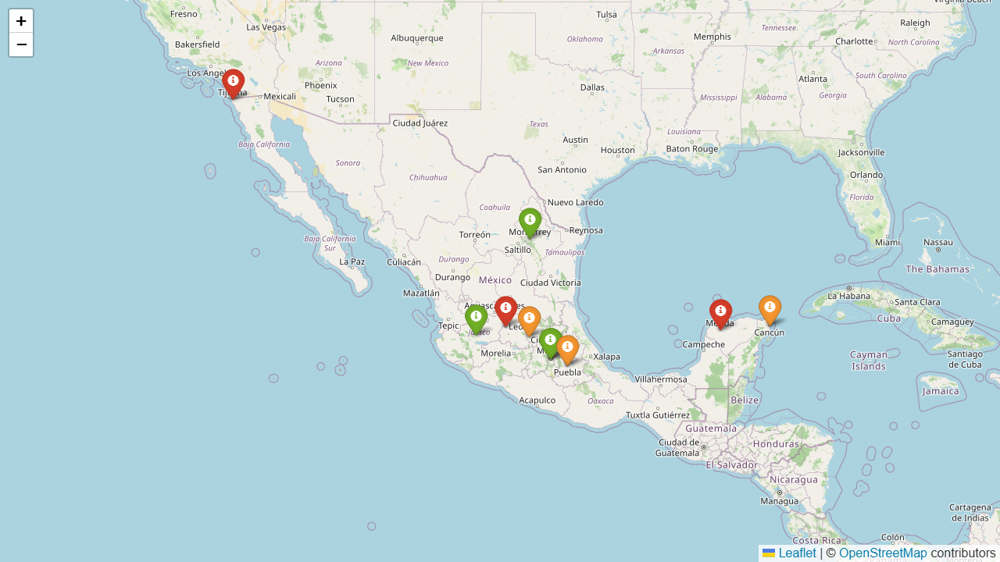

# Episodio 3: del Excel al mapa

| Archivo | Qué hace |
| --- | --- |
| `sucursales.xlsx` | Las 10 Tiendas PyHero: `nombre`, `ciudad`, `lat`, `lon` y `ventas` |
| `excel_al_mapa.py` | Lee el Excel con Pandas y pone un pin por cada fila, con `df.iterrows()` |
| `boss_sucursales_fantasma.py` | Boss: las Sucursales Fantasma. Cada pin sale verde, naranja o rojo según sus ventas, con una función `if/elif/else` |
| `mision.py` + `mis_sucursales.xlsx` | Misión resuelta: el mismo código del Boss con una tienda más en el Excel (Oaxaca). El Python no cambia: solo el Excel |

Corre un script desde esta carpeta (para que encuentre el Excel) y abre el `.html` que se crea con doble clic.

```bash
pip install folium pandas openpyxl
```



## Recorrer el Excel fila por fila

```python
for _, fila in df.iterrows():
    folium.Marker([fila["lat"], fila["lon"]], popup=fila["nombre"]).add_to(mapa)
```

`df.iterrows()` te da, en cada vuelta, dos cosas: el número de la fila y la fila con sus datos. El número no lo
usamos, así que lo guardamos en `_` (guion bajo), que en Python quiere decir "esto no me importa". De la fila sacas
cada dato con el nombre de su columna: `fila["lat"]`, `fila["lon"]`, `fila["nombre"]`…

## El color según las ventas

```python
def color_por_ventas(ventas):
    if ventas >= 500000:
        return "green"
    elif ventas >= 250000:
        return "orange"
    else:
        return "red"
```

Una función (Nivel 4) con `if/elif/else` (Nivel 2). En el `for`, `icon=folium.Icon(color=color_por_ventas(fila["ventas"]))`
le pone a cada pin su color.

## Errores comunes

| Error | Solución |
| --- | --- |
| `FileNotFoundError: sucursales.xlsx` | Corre el script desde esta carpeta (o pon la ruta completa del Excel) |
| `ImportError: Missing optional dependency 'openpyxl'` | Pandas necesita openpyxl para leer `.xlsx`: `pip install openpyxl` |
| `KeyError: 'lat'` | El nombre de la columna no coincide: revisa que en el Excel diga exactamente `lat` (sin espacios ni mayúsculas) |
| Tu tienda nueva sale en el mar | Revisa que la latitud y la longitud no estén al revés, y que en México la longitud sea **negativa** |
| Cambiaste el Excel y el mapa no cambia | Guarda el Excel, vuelve a correr el script y recarga el `.html` en el navegador |

Mapas: © [OpenStreetMap](https://www.openstreetmap.org/copyright) contributors.
