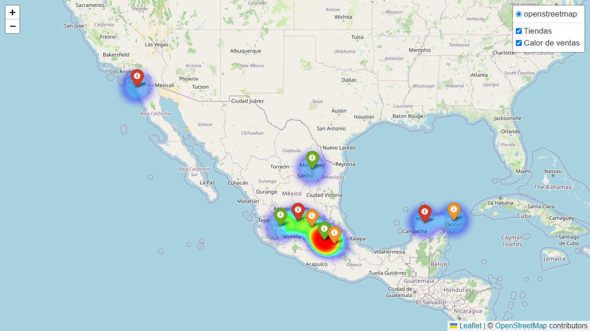

# Episodio 4: Boss final, mapa de calor y capas

| Archivo | Qué hace |
| --- | --- |
| `sucursales.xlsx` | Las 10 Tiendas PyHero, con una columna nueva: `clientes` (para la misión) |
| `mapa_calor.py` | Tu primer mapa de calor: cada tienda pesa según sus ventas |
| `boss_mapa_sucursales.py` | Boss final: las tiendas de colores y el calor en **capas** que se prenden y apagan, con el zoom justo (`fit_bounds`) |
| `mision.py` | Misión resuelta: el mismo mapa del Boss, pero el calor mide los **clientes** |

Corre un script desde esta carpeta y abre el `.html` que se crea. En el mapa del Boss, el botón de capas está arriba a la derecha.

```bash
pip install folium pandas openpyxl
```



## El mapa de calor

```python
from folium.plugins import HeatMap

df["peso"] = df["ventas"] / df["ventas"].max()
puntos = df[["lat", "lon", "peso"]].values.tolist()
HeatMap(puntos, radius=35, blur=15, max_zoom=5).add_to(mapa)
```

- `HeatMap` vive en los **plugins** de Folium (los extras), por eso se importa aparte.
- Quiere una lista con `[latitud, longitud, peso]` por cada punto. El peso va de 0 a 1: la tienda que más vende pesa 1.
- `radius` es el tamaño de cada mancha y `blur`, qué tan borrosa.
- `max_zoom=5`: el calor solo respeta el peso completo a partir de ese zoom. Si lo quitas, con el mapa de todo el
  país casi todas las tiendas calientan igual, y solo se pone rojo donde hay varias juntas. Si haces un mapa de
  una sola ciudad (zoom 12, por ejemplo), súbelo a ese zoom.

## Las capas

```python
tiendas = folium.FeatureGroup(name="Tiendas")      # una capa vacía, con su nombre
folium.Marker(...).add_to(tiendas)                  # los pines van a la capa, no al mapa
tiendas.add_to(mapa)                                # y la capa completa, al mapa

HeatMap(puntos, name="Calor de ventas", ...).add_to(mapa)   # el calor también es una capa
folium.LayerControl().add_to(mapa)                  # el botón para prender y apagar capas
mapa.fit_bounds(df[["lat", "lon"]].values.tolist()) # el zoom justo para que quepan todas
```

## Errores comunes

| Error | Solución |
| --- | --- |
| `ImportError: cannot import name 'HeatMap'` | Va con su ruta completa: `from folium.plugins import HeatMap` |
| El mapa de calor se ve igual con cualquier peso | Revisa `max_zoom`: debe ser igual (o menor) al zoom con el que ves el mapa |
| `KeyError: 'clientes'` | Usa el `sucursales.xlsx` de esta carpeta: el del Episodio 3 no trae esa columna |
| El selector de capas no aparece | `folium.LayerControl().add_to(mapa)` va **después** de agregar todas las capas |
| Los pines salen aunque apagues la capa | Los pines deben ir `.add_to(tiendas)`, no `.add_to(mapa)` |

Mapas: © [OpenStreetMap](https://www.openstreetmap.org/copyright) contributors.
